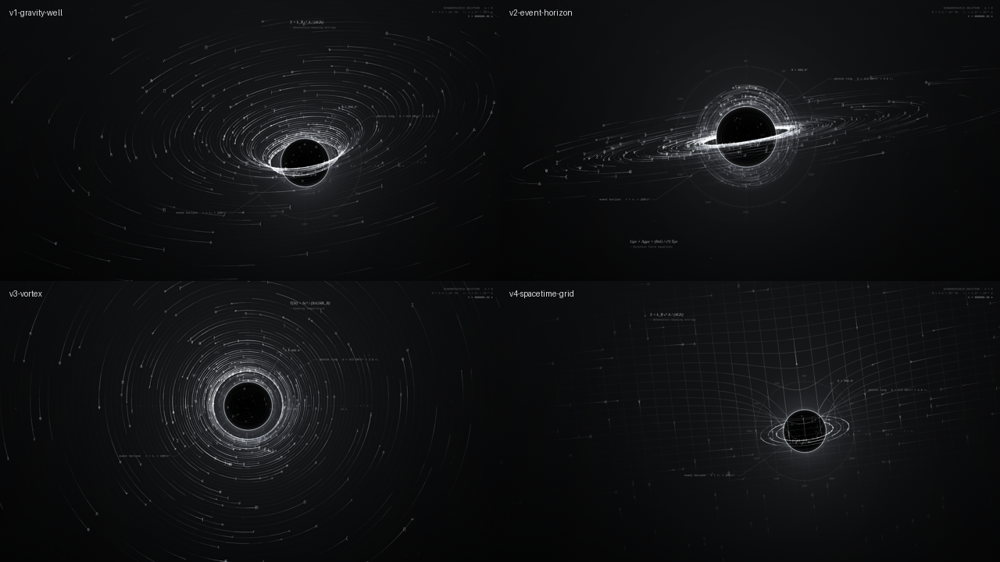
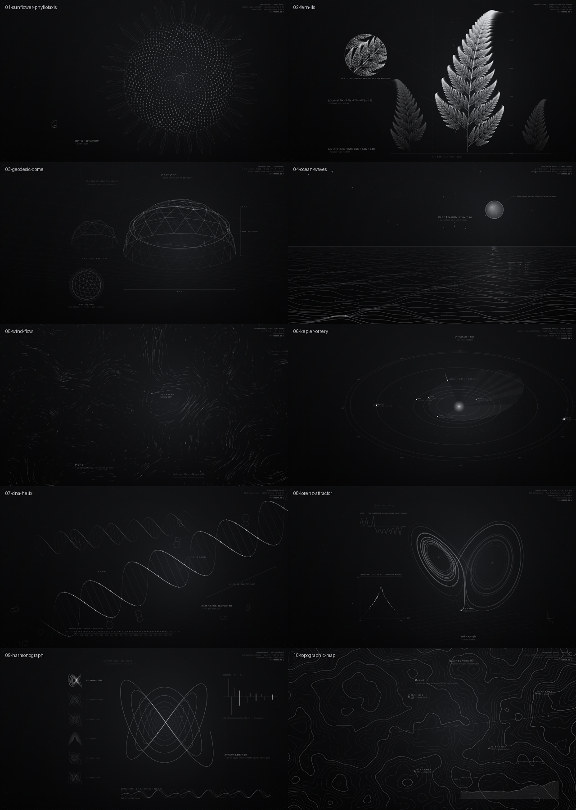
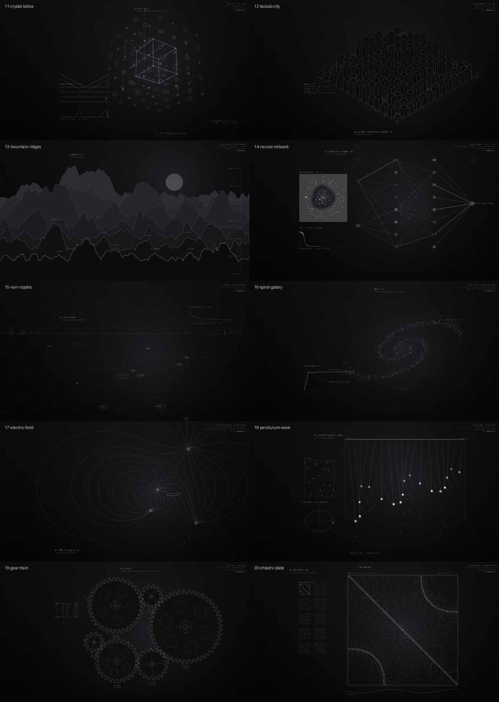
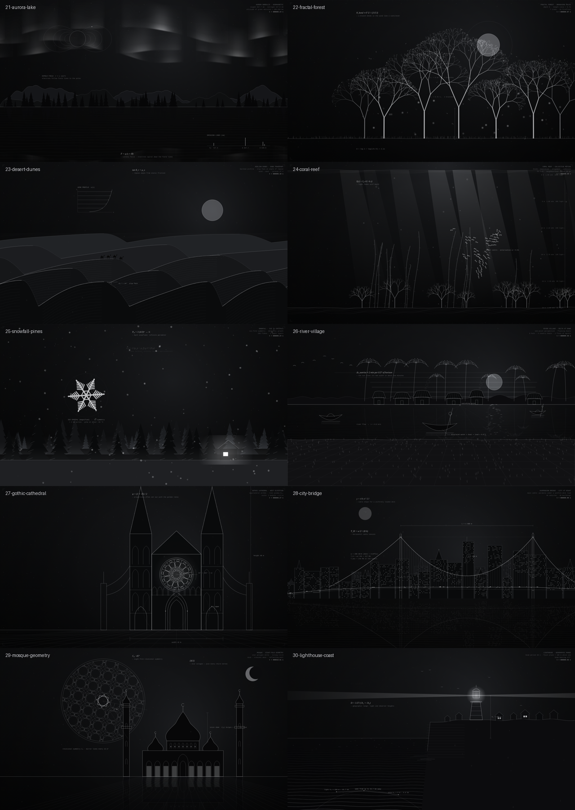
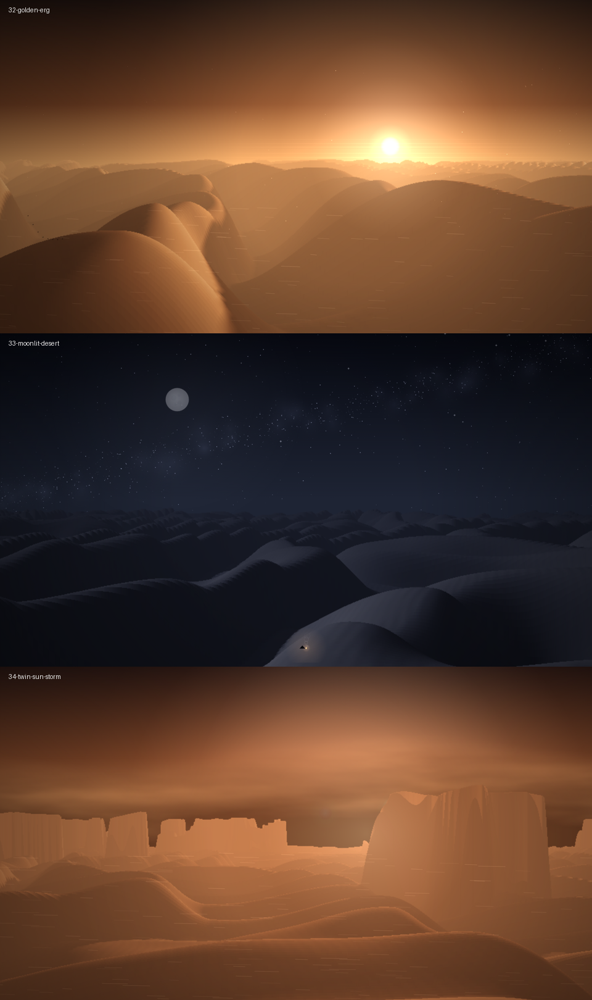

# Live Wallpapers — optimized for Lively

**38 animated desktop wallpapers where the picture *is* the maths.**
Black holes made of ASCII characters, sunflowers growing by the golden angle, a neural network that really trains, a Lorenz attractor showing the butterfly effect, Gothic cathedrals, river villages, moonlit deserts — each one a single, self-contained HTML file that runs in [Lively Wallpaper](https://github.com/rocksdanister/lively) for Windows.

Most scenes are drawn in a minimal grey line style on dark gradients, with real equations that type themselves out on screen and live readouts tied to what you're watching. The three *realistic* scenes render a lit 3D desert landscape every frame.



---

## Contents

| Folder | What's inside |
| --- | --- |
| [`wallpapers/black-hole/`](wallpapers/black-hole) | 4 versions of an ASCII black hole: gravity well, side-on event horizon, top-down vortex, warped spacetime grid |
| [`wallpapers/math-series/`](wallpapers/math-series) | 20 scenes from mathematics, physics, biology and computer science |
| [`wallpapers/nature-and-architecture/`](wallpapers/nature-and-architecture) | 11 scenes: aurora, forest, reef, snow, dunes, river village, cathedral, city bridge, mosque, lighthouse, desert world |
| [`wallpapers/realistic/`](wallpapers/realistic) | 3 realistic, softly lit 3D desert landscapes |
| [`previews/`](previews) | Still frames of every wallpaper |
| [`source/`](source) | The shared engine, one script per scene, and the build script that assembles them into HTML |

### Math series



| # | Wallpaper | What you see | The maths |
| --- | --- | --- | --- |
| 01 | Sunflower | ~1,100 seeds growing outward, petals, a golden-spiral diagram | Vogel's model θ = n·137.508°, r = c√n; Fibonacci parastichies |
| 02 | Fern | A fern built from four affine maps, swaying; a magnifier shows self-similarity | Barnsley's iterated function system (chaos game) |
| 03 | Geodesic dome | Two rotating domes, a laser scan plane, plan view | Subdivided icosahedron; Euler's V − E + F |
| 04 | Ocean | Moonlit sea, Milky Way, starlight glints on the crests | Deep-water dispersion ω² = gk; superposed waves |
| 05 | Wind | ~1,700 tracers following a swirling wind field | Divergence-free curl-noise flow; Navier–Stokes |
| 06 | Orrery | Planets on real Kepler ellipses, moons, a comet sweeping equal areas | Kepler's equation M = E − e sin E; second and third laws |
| 07 | DNA | Rotating B-DNA, codon → amino-acid ticker | 10.5 bp/turn, 3.4 nm pitch; the standard genetic code |
| 08 | Lorenz attractor | Two trajectories 10⁻⁵ apart drifting into different paths; Lorenz map | σ = 10, ρ = 28, β = 8/3; Lyapunov exponent ≈ 0.906 |
| 09 | Harmonograph | Pendulum curves for musical intervals, shared-harmonic chart | Frequency ratios 3:2, 4:3, 5:4 …; consonance |
| 10 | Topographic map | Shifting terrain as contour lines, survey stations, A–B profile | Marching squares on fractal noise; gradient ∇h |
| 11 | Crystal lattice | Rotating rock-salt lattice, Bragg diffraction panel | nλ = 2d sin θ; Madelung constant |
| 12 | City grid | Isometric city with traffic and an A→B route | Taxicab distance; C(Δx+Δy, Δx) shortest paths |
| 13 | Mountain ridges | Layered ridges fading into haze, birds, peak heights | Beer–Lambert haze; barometric formula |
| 14 | Neural network | A 2-8-8-1 network actually training live; decision boundary and loss | Backpropagation, binary cross-entropy, SGD |
| 15 | Rain ripples | Rain on a pond, expanding rings, lily pads | 2D wave equation; amplitude ∝ 1/√r |
| 16 | Spiral galaxy | 7,500 stars, rigid density-wave arms, rotation curve | Logarithmic spiral; flat rotation curve (dark matter) |
| 17 | Electric field | Four drifting charges with field lines traced every frame | Coulomb superposition; Gauss's law |
| 18 | Pendulum wave | 18 pendulums drifting through wave patterns and realigning | T = 2π√(L/g); Γ = 60 s cycle |
| 19 | Gear train | Six meshing spur gears with rpm labels and ratio table | ω₁N₁ = ω₂N₂; involute tooth profile |
| 20 | Chladni plate | 9,000 grains of sand gathering on nodal lines | cos(nπx)cos(mπy) − cos(mπx)cos(nπy) = 0 |



### Nature & architecture



| # | Wallpaper | What you see |
| --- | --- | --- |
| 21 | Aurora lake | Northern lights over mountains, mirrored in a lake; Earth's dipole field and emission lines |
| 22 | Fractal forest | Seven trees grown from one branching rule, fireflies, falling leaves |
| 23 | Desert dunes | Wind ripples, sand blowing off crests, a camel caravan, angle of repose |
| 24 | Coral reef | Light shafts, a fish school (boids), kelp, bubbles that grow as they rise |
| 25 | Snowfall | Misty pine forest, a cabin, six-fold snowflakes and a magnified crystal |
| 26 | River village | Thatched huts and palms on a Bengal riverbank at dawn, country boats, rice fields in perspective |
| 27 | Gothic cathedral | An architect's elevation with a turning 12-fold rose window and arch construction circles |
| 28 | City & bridge | Night skyline reflected in a river; a suspension bridge with a true parabolic cable |
| 29 | Mosque | Domes and minarets by a reflecting pool under an eight-fold star pattern |
| 30 | Lighthouse | A sweeping beam over a fishing village; horizon distance d ≈ 3.57√h km |
| 31 | Desert world | An original two-sun desert planet: ringed giant, carved city, sand yachts, storm wall |

### Realistic



| # | Wallpaper | What you see |
| --- | --- | --- |
| 32 | Golden erg | A slow flight over endless dunes at sunset, with haze and a tiny caravan far ahead |
| 33 | Moonlit desert | Silver moonlight on dunes under the Milky Way, a small campfire, the odd meteor |
| 34 | Twin suns & storm | Flat-topped buttes and a vast dust storm swallowing two setting suns |

---

## Installing in Lively

1. Install **Lively Wallpaper** (free, open source) from the Microsoft Store or from its [GitHub releases](https://github.com/rocksdanister/lively/releases).
2. Download this repository (**Code → Download ZIP**) and unzip it somewhere permanent, e.g. `Documents\Wallpapers`.
3. In Lively, click **+ (Add Wallpaper)** → **Browse** → pick any `.html` file from `wallpapers/`.
4. Click **OK** on the preview dialog (it may take a few seconds while Lively captures a thumbnail), then click the wallpaper in your library to apply it.

**Recommended Lively settings** (gear icon):
- *Performance → When another app is fullscreen*: **Pause** — so games run at full speed.
- *Wallpaper → Wallpaper input*: **Mouse** — enables the gentle mouse parallax.

## Customising

Every file starts with a `SETTINGS` block you can edit in Notepad:

```js
const SETTINGS = {
  theme: 'grey',    // 'grey' | 'warm' | 'green' | 'ice' | 'amber'
  math: true,       // equations, labels and readouts (false = clean version)
  parallax: true,   // gentle shift with the mouse
  fps: 30,          // frame cap; 30 keeps the GPU/CPU load low
  // …plus options specific to each scene (density, speed, palette, …)
};
```

Save the file, then remove and re-add it in Lively to see the change.

## Performance

All scenes are capped at **30 fps** and were designed to run on integrated graphics (tested target: AMD Ryzen 5 5600GT with Radeon Vega 7, 1920×1080). The black hole, math and nature scenes are light. The three **realistic** scenes render a 3D heightfield on the CPU every frame and take about a second to build their terrain at start-up; if one feels heavy, set `fps: 20`.

## Building from source

The HTML files in `wallpapers/` are generated. To change a scene, edit its script in `source/scenes/`, then run:

```bash
cd source
python3 build.py      # writes the assembled HTML files to source/out/
```

`source/common.js` is the shared engine (background, palette, frame loop, typed-equation overlay, Perlin noise). `source/terrain.js` is the heightfield renderer used by the realistic scenes.

---

## References

The equations shown on screen are standard results. Good starting points if you want to read more:

**Tools**
- [Lively Wallpaper](https://github.com/rocksdanister/lively) — the open-source live-wallpaper app these are made for
- [HTML Canvas 2D API](https://developer.mozilla.org/en-US/docs/Web/API/Canvas_API) — everything is drawn with it, no libraries
- [Perlin noise](https://en.wikipedia.org/wiki/Perlin_noise) — the procedural noise behind terrain, wind and clouds
- [Voxel Space](https://en.wikipedia.org/wiki/Voxel_Space) — the column-based heightfield rendering used by the realistic scenes

**Space & physics**
- [Schwarzschild metric](https://en.wikipedia.org/wiki/Schwarzschild_metric) · [Photon sphere](https://en.wikipedia.org/wiki/Photon_sphere) · [Gravitational lensing](https://en.wikipedia.org/wiki/Gravitational_lens)
- [Kepler's laws of planetary motion](https://en.wikipedia.org/wiki/Kepler%27s_laws_of_planetary_motion) · [Roche limit](https://en.wikipedia.org/wiki/Roche_limit) · [Circumbinary planet](https://en.wikipedia.org/wiki/Circumbinary_planet)
- [Galaxy rotation curve](https://en.wikipedia.org/wiki/Galaxy_rotation_curve) · [Density wave theory](https://en.wikipedia.org/wiki/Density_wave_theory)
- [Aurora](https://en.wikipedia.org/wiki/Aurora) · [Electric field](https://en.wikipedia.org/wiki/Electric_field) · [Bragg's law](https://en.wikipedia.org/wiki/Bragg%27s_law)
- [Lorenz system](https://en.wikipedia.org/wiki/Lorenz_system) · [Pendulum](https://en.wikipedia.org/wiki/Pendulum) · [Ernst Chladni](https://en.wikipedia.org/wiki/Ernst_Chladni)
- [Wave equation](https://en.wikipedia.org/wiki/Wave_equation) · [Dispersion of water waves](https://en.wikipedia.org/wiki/Dispersion_(water_waves)) · [Navier–Stokes equations](https://en.wikipedia.org/wiki/Navier%E2%80%93Stokes_equations) · [Stokes' law](https://en.wikipedia.org/wiki/Stokes%27_law)
- [Beer–Lambert law](https://en.wikipedia.org/wiki/Beer%E2%80%93Lambert_law) · [Aeolian processes (wind-blown sand)](https://en.wikipedia.org/wiki/Aeolian_processes) · [Horizon distance](https://en.wikipedia.org/wiki/Horizon#Distance_to_the_horizon)

**Nature & biology**
- [Phyllotaxis](https://en.wikipedia.org/wiki/Phyllotaxis) · [Golden angle](https://en.wikipedia.org/wiki/Golden_angle) · [Fibonacci sequence](https://en.wikipedia.org/wiki/Fibonacci_sequence)
- [Barnsley fern](https://en.wikipedia.org/wiki/Barnsley_fern) · [L-system](https://en.wikipedia.org/wiki/L-system) · [Koch snowflake](https://en.wikipedia.org/wiki/Koch_snowflake)
- [Nucleic acid double helix](https://en.wikipedia.org/wiki/Nucleic_acid_double_helix) · [Genetic code](https://en.wikipedia.org/wiki/Genetic_code)
- [Boids (flocking)](https://en.wikipedia.org/wiki/Boids)

**Maths, computing & engineering**
- [Marching squares](https://en.wikipedia.org/wiki/Marching_squares) · [Taxicab geometry](https://en.wikipedia.org/wiki/Taxicab_geometry) · [Geodesic polyhedron](https://en.wikipedia.org/wiki/Geodesic_polyhedron)
- [Harmonograph](https://en.wikipedia.org/wiki/Harmonograph) · [Just intonation](https://en.wikipedia.org/wiki/Just_intonation)
- [Backpropagation](https://en.wikipedia.org/wiki/Backpropagation) · [Involute gear](https://en.wikipedia.org/wiki/Involute_gear)

**Architecture**
- [Pointed arch](https://en.wikipedia.org/wiki/Pointed_arch) · [Rose window](https://en.wikipedia.org/wiki/Rose_window) · [Flying buttress](https://en.wikipedia.org/wiki/Flying_buttress)
- [Suspension bridge](https://en.wikipedia.org/wiki/Suspension_bridge) · [Catenary](https://en.wikipedia.org/wiki/Catenary)
- [Islamic geometric patterns](https://en.wikipedia.org/wiki/Islamic_geometric_patterns) · [Manning formula (river flow)](https://en.wikipedia.org/wiki/Manning_formula)

---

*All scenes are original designs. Made by [RafTan10](https://github.com/RafTan10).*
